# GRAND THEFT MOTO

**ID `GrandTheftMoto-5S`** · *If it has a motor, it's yours.*

Grand Theft Moto is an original spiritual successor to *Grand Theft Auto 2* (PC), with *Grand Theft Auto V*-depth
systems, in the my-3D2dge 2D pixel style. It is one self-contained HTML file: no install, no network, no image or sound
files. Everything is drawn and played by code.

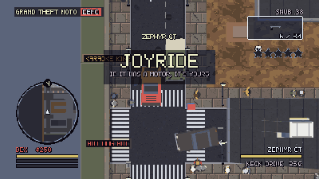

The city is three districts, a bridge apart: **Lowtown** (the docks, the neon and the brick), **Ironside** (the
foundry, the scrapyards and the power station) and **Glass Heights** (the hill, the Strip and the marina), each with
its gangs, missions and side content, opened one by one as the story goes on. It is seen four ways:
- **ISOMETRIC** (primary), with a camera that turns (a tap a quarter; held, a spin that settles on one of eight angles)
  and pulls out with speed;
- **TOP-DOWN**: GTA2's perspective lean, the camera climbing as you go faster and turning smoothly to any angle;
- **SIDE-SCROLL MODE 7**: the engine's side scrolling with depth, a rail camera that follows you sideways while the
  avenues recede into the distance, its rail turned smoothly to any angle;
- **CHASE**: a free-turning Mario Kart-style camera behind what you drive (or the way you walk), pulled in short of the
  walls.

Switch any time (R3); the simulation never notices which view you watch it in. There are cars, bikes and trucks to
take, a helicopter, two planes and four boats; the L to ride; four interiors (the First Lowtown Bank, Club Chrome, the
Ironside Power Station and the Velvet Casino), three heists in them; and an arcade cabinet in Club Chrome that plays
the engine's own shooter starter kit.

| ISO at night | MODE 7 in the rain | TOP-DOWN |
|---|---|---|
| 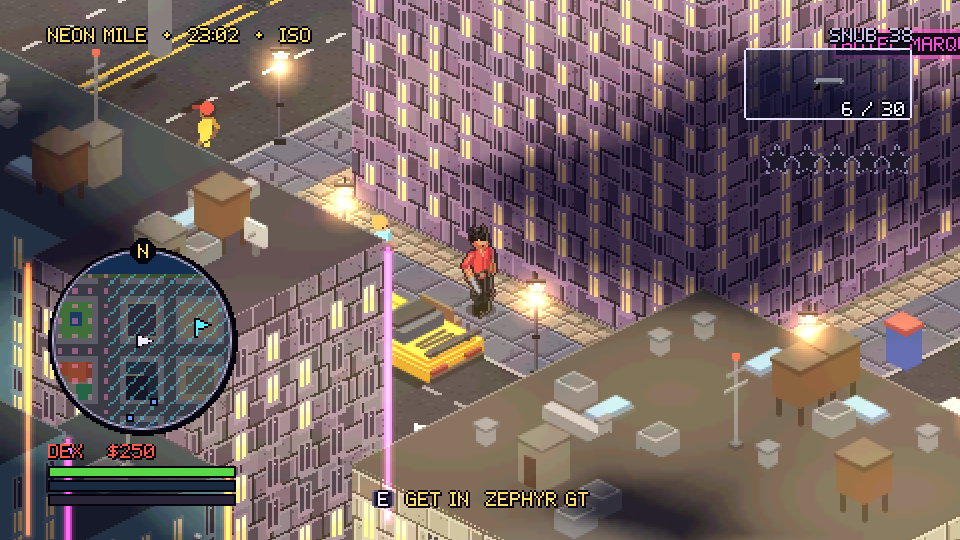 | 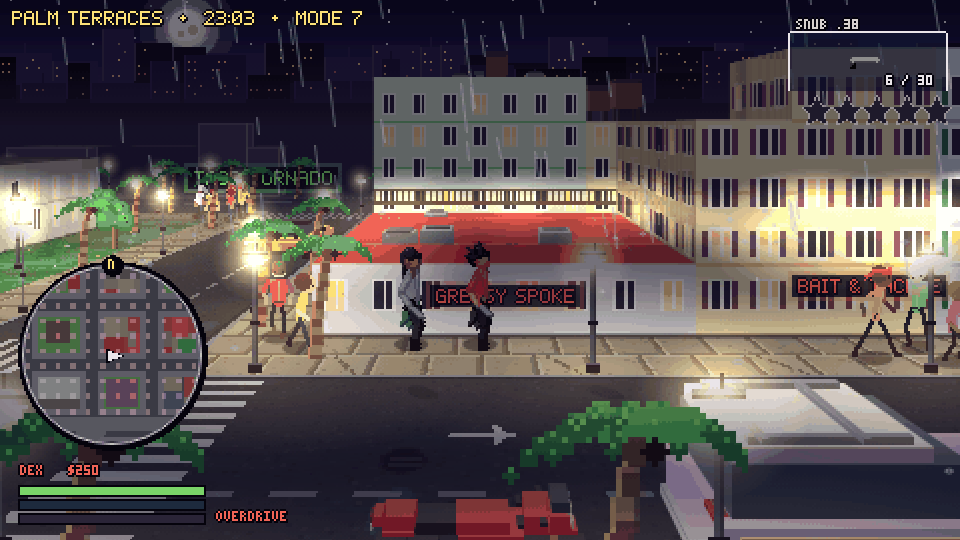 | 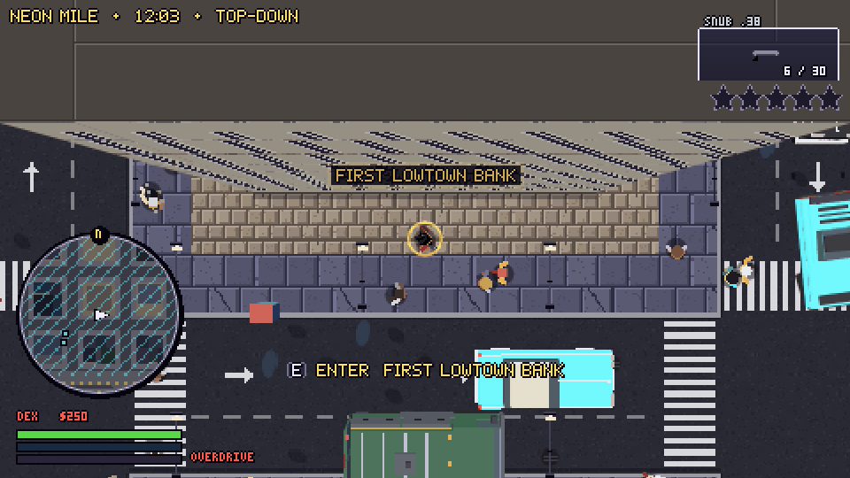 |
| **The First Lowtown Bank** | **The HUD in a car** | **JOB DONE** |
| 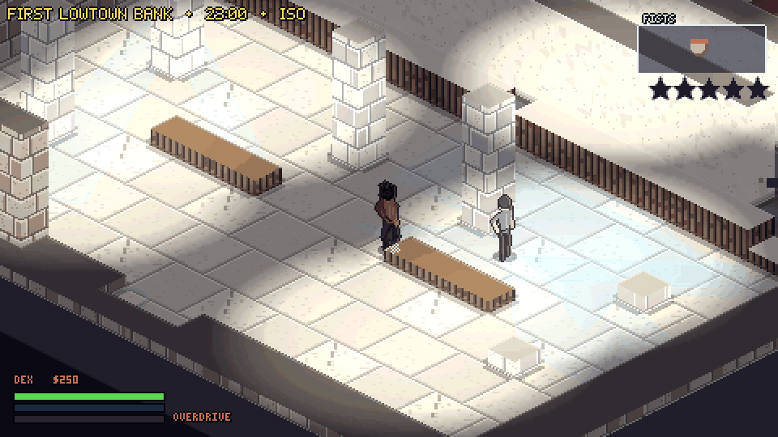 | 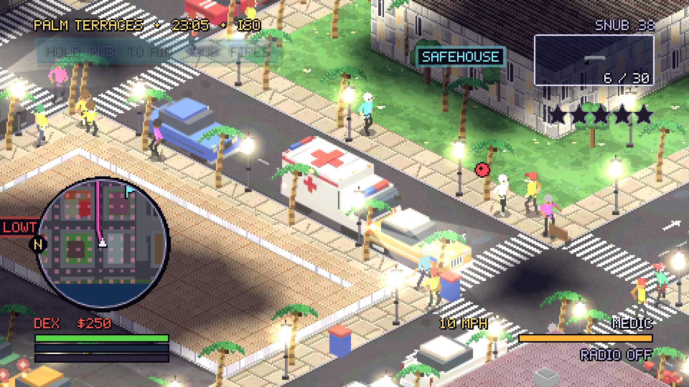 | 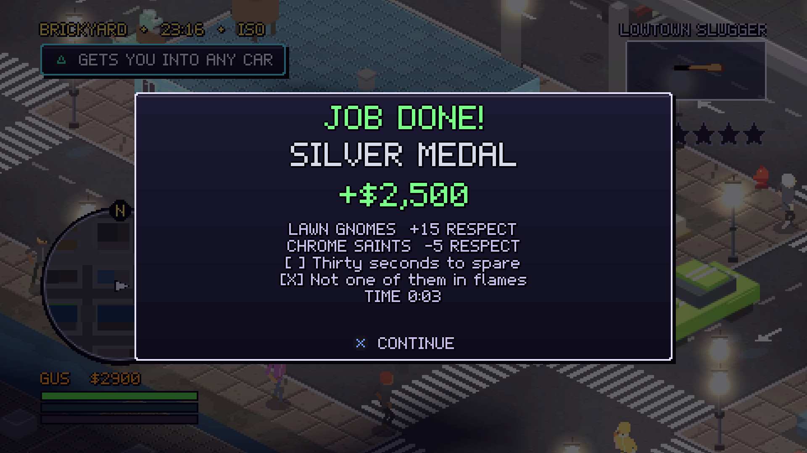 |
| **SkyCam, behind it in CHASE** | **CHROME RAIDERS in Club Chrome** | **Riding the L** |
| 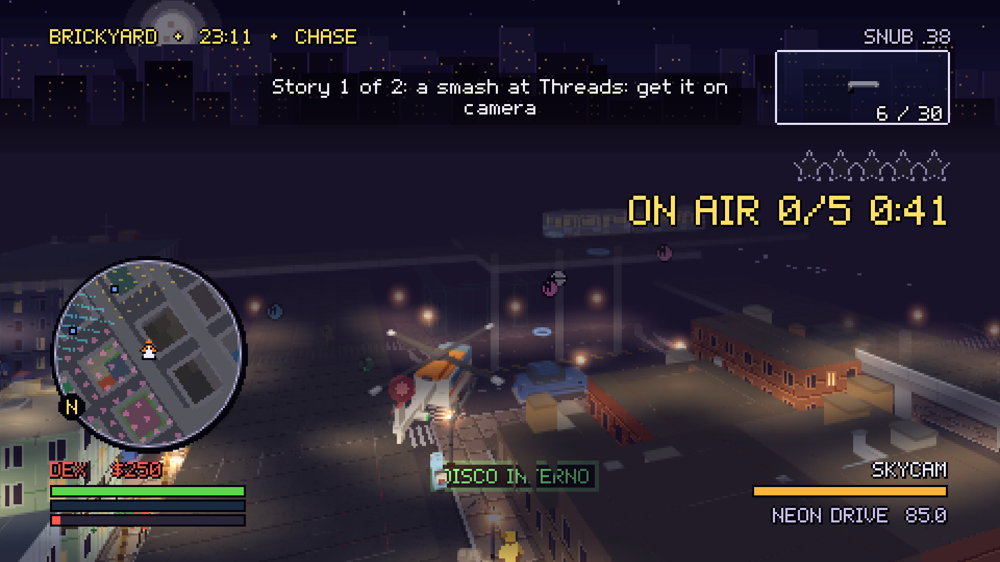 | 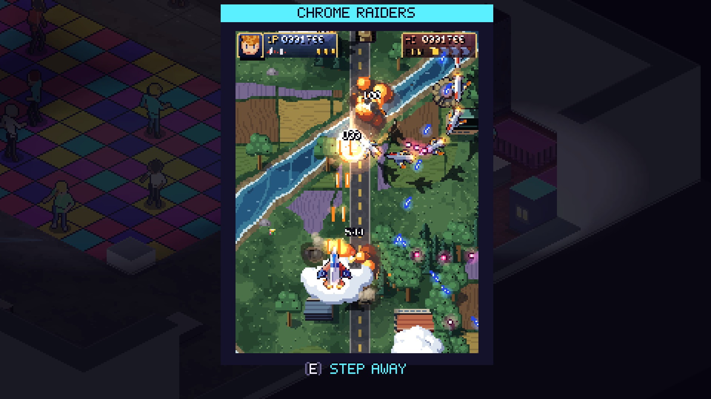 | 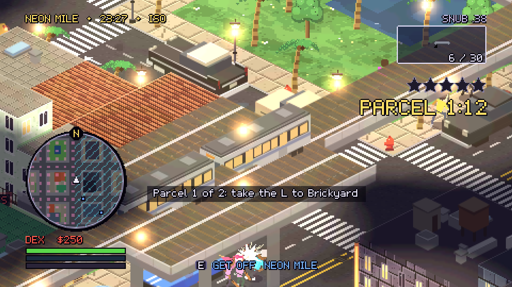 |
| **Ironside: the Duster over the works** | **The Velvet Casino's floor** | **Glass Heights: the Villa Pool jump** |
| 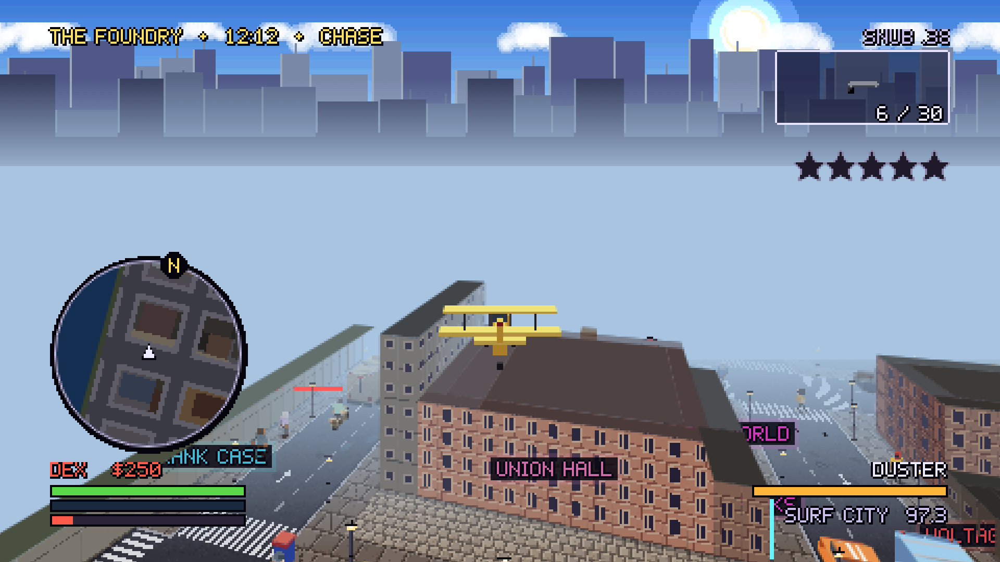 | 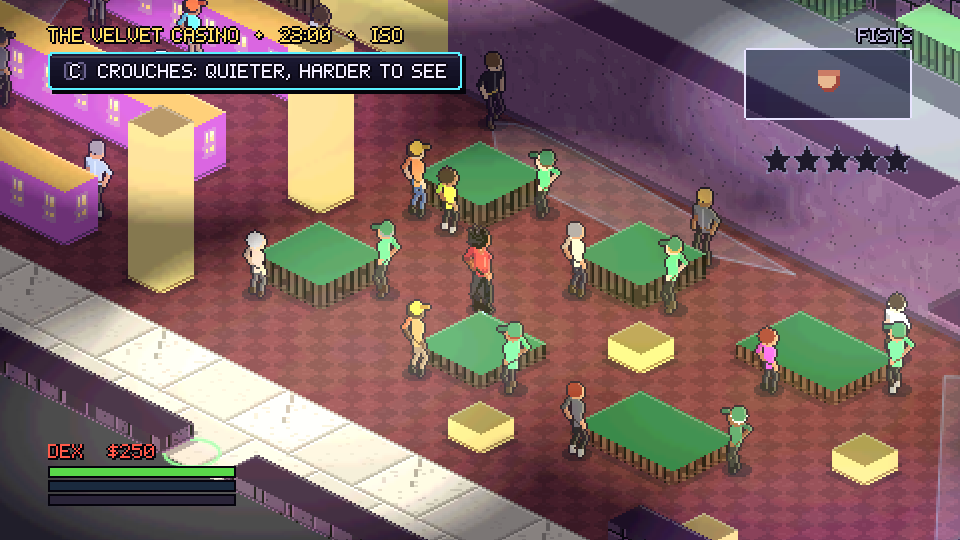 | 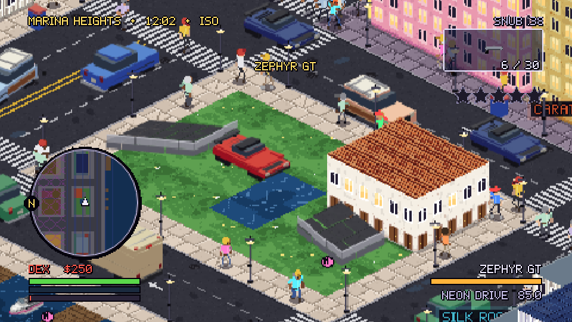 |

## What's in it

- **Three protagonists**, switched between on the fly: Dex Moreno the courier and wheelman, Viv Okafor the
  ex-detective, Gus Pilchard the tow-truck philosopher, each with an ability of their own.
- **32 missions** for seven gangs: the prologue; the Chrome Saints, the Harbor Rats and the Lawn Gnomes in Lowtown;
  the Rust Monks and the Volt Boys in Ironside; the Velvet Syndicate and the Yacht Club in Glass Heights (the Saints
  uptown too); and three heists, each in three setups and a finale: the First Lowtown Bank (LOUD or QUIET), Blackout
  at the Power Station, House Edge at the Velvet Casino.
- **Side content:** nine jobs at three levels (Moto Courier, Vigilante, Firefighter, Paramedic, Tow Truck, SkyCam in
  the helicopter, L Courier on the train, Crop Duster in the Duster, Limo on the Heights' doors), four races (two
  street races, the Ironside Air Race, the Heights Regatta on the water), five MAYHEMs, a high score on Club Chrome's
  cabinet, 55 Moto Tokens, eleven stunt jumps, six properties to buy, the Kwik-Lux hold-ups, random events, shops and
  the respray.
- **A city that lives:** traffic on one-way streets, the Loop's elevated deck and the bridges between the districts,
  crowds on the sidewalks, the police by wanted level (up to a helicopter and roadblocks), ambulances and fire
  engines, seven gangs with respect, turf and turf wars, a drawbridge, boats on the water, weather and a day.
- **A controller-first 10-foot UI** for a DualSense on a TV (keyboard and mouse work too): the HUD, the phone, the
  map, the pause, every setting, rebinding per context.
- **Sound:** six radio stations composed at run time (synth-punk, boom-bap, synthwave, surf rock, lounge and a talk
  show), with DJs and ads, and a score that comes up under the action.
- **An attract mode** that plays the game by itself after ten idle seconds on the title (seven reels, the districts'
  among them), and leaves on any input.
- **The Proving Ground** (EXTRAS on the title): the handling ground, the traffic lab, the combat range, a wanted
  sandbox, the mission bench, a stress pad, the UI gallery and jukebox, photo mode (with its filters) and the dev tools
  (`?dev=1`).

## How to play

Open `dist/index.html` in a desktop browser (Chromium, Chrome or Edge play it best) and press any button. Plug in a
controller first if you have one.

- **Start:** NEW GAME. The prologue teaches the verbs: walk, get in, drive, deliver.
- **Jobs come from payphones:** a ringing payphone on a gang's turf, or the crew's at the Greasy Spoke. Walk into its
  marker to see the JOB card. The phone (D-pad up) has your contacts, texts, and the city's jobs.
- **Money** buys guns, a respray (loses the police), the properties (they pay a little each night) and the heists.
- **The districts open with the story:** Lowtown's heist opens the west bridge to Ironside, Ironside's the Loop
  Causeway to Glass Heights. Drive over (or walk); your car, crew, time and stars come with you.
- **Respect** with each gang rises with its jobs and falls with its rivals'. Hostile gangs go for you on their turf;
  friendly ones back you up.
- **Stars** come from crimes the police see. Lose them out of sight, or at the respray. A job never starts while you
  are wanted (nor a crew switch, nor a cab): lose the stars first.
- **The pause** (Options) has the map, your brief, the stats (the completion percentage), the settings and help.

## Controls

The defaults; every one can be rebound per context in SETTINGS, CONTROLS. The full list is in
[`docs/CONTROLS.md`](docs/CONTROLS.md).

| Action | DualSense | Keyboard and mouse |
|---|---|---|
| Move / steer | left stick | WASD |
| Aim / look | right stick (L2 locks on) | mouse (right button locks on) |
| Attack / fire | R2 | left button |
| Accelerate / brake and reverse | R2 / L2 (analog) | W / S |
| Get in, out, use | △ | E |
| Sprint / horn | ✕ | Shift / H |
| Jump, climb / handbrake | □ / R1 | Space |
| Roll / drive-by | ○ | X / left button |
| Weapon wheel / nitro | L1 | Q / Shift |
| Change view | R3 (tap) | V |
| Turn the camera (tap: a quarter; hold: spin) | R3 held, right stick | [ and ] |
| Phone | D-pad ↑ | T |
| Switch character | D-pad ↓ | Z |
| Radio | D-pad ← → (in a vehicle) | , and . |
| Map | touchpad | M or Tab |
| Photo mode | Create | B |
| Pause | Options | Esc |

A DualSense's adaptive triggers and light bar answer in Chrome and Edge (SETTINGS, CONTROLS, DualSense haptics, switched
on with a key or a click the first time, and the browser asks which device) and in the desktop app at once: R2 and L2
by the gun or the car in hand, the light bar the character's colour, red and blue under stars.

## Source Information

| Item | Value |
|---|---|
| **Initial Date** | 2026-10-17 (UTC): the first prompt of the planning session. The repository was created on 2026-10-16 at 19:29 UTC-7. |
| **SOURCE** | *Grand Theft Auto 2* (PC, 1999; DMA Design / Rockstar Games), with depth, features and gameplay drawn from *Grand Theft Auto V* (2013; Rockstar North). In the my-3D2dge 2D pixel style, with the views isometric (primary), top-down (secondary), and the engine's side scrolling with depth (Mode 7). |
| **GAME ENGINE** | **my-3D2dge v0.46.1**, commit `cfa866a` (`cfa866aa45474868350cad1a7fc015e612f9305f`, 2026-10-15), <https://github.com/michaelcrosato/my-3d2dge> (MIT). It is vendored at `vendor/my-3d2dge/` and extended by MOTOR (`src/motor/`). |
| **Environment** | Claude Code (2.1.302 when the run began, 2.1.309 at the slice's end, 2.1.311 at L1-L8's) in Anthropic's managed cloud environment: claude.ai/code remote sessions, started from the Claude desktop app. Linux: Ubuntu 24.04.5 LTS, x86_64. Node.js 22.22.0. Headless Chromium (Playwright 1.56.1) for the tests: 141 (build 1194) for the slice, the container's 153 (build 1243) from L1 on (D32). Electron 44.7.0 for the desktop wrapper, run and packed by CI (D46). The game targets desktop browsers and runs from one HTML file. |
| **Model and Effort Level** | AI lab: **Anthropic**. Effort: **max**, for the planning and for every implementation session of the slice (M0-M13), with `ultracode` for the fan-outs; **xhigh** for the run after it (L1-L8, one session), confirmed from that session's metadata. The exact model is given in each session's chat report: this environment keeps model identifiers out of files pushed to the repository. |

## Game engine analysis

Kept separate from the Source Information above; the full analysis is [`docs/ENGINE-ANALYSIS.md`](docs/ENGINE-ANALYSIS.md),
and the feedback for the engine's maintainers is [`docs/FEEDBACK-FOR-ENGINE.md`](docs/FEEDBACK-FOR-ENGINE.md).

- **Used:** the exact fixed-step loop and headless stepping (the whole test plan runs the real game in Node), scenes
  and fades, the pixel primitives and font, `TileMap` for the buildings, the depth-sorted renderer and the `iso`
  view, canvas lighting, particles, `E.Humanoid` with its mocap, `E.Mover` and `E.ACTIONS`, perception (`E.sees`,
  `E.hears`, `E.Suspicion`), `E.Bullets` and the melee helpers, the input with DualSense detection and rumble,
  `ChipAudio`, `E.store`, the session recorder and the checker. The stress test's side scrolling with depth became
  MODE 7, and the shooter kit's one-point lean became TOP-DOWN.
- **Not used:** the agent edition, the 3D engine, the platformer kit, the whole-map floor bake, `E.Shell` and the HTML
  menus (not readable at 10 feet), the orthographic top-down view, circle bodies for cars, `music()` for the radio, GPU
  lighting.
- **Patched** in seven places, each recorded with the issue text to offer upstream
  ([`vendor/my-3d2dge/PATCHES.md`](vendor/my-3d2dge/PATCHES.md)).
- **The one thing to change:** make the world scale. A chunked, streamed `TileMap` (floors baked per chunk on demand,
  walls found within the view, bounded caches, solids indexed by place, and cells with space under bridges). Four of
  the seven patches exist only because the map is a city.

## Building and testing

- **Play:** `dist/index.html` (committed, rebuilt by every change).
- **Build:** `npm ci` (Node 22 or later), then `npm run build`. `npm run dev` serves it on `localhost:5173` and rebuilds
  on every change.
- **Test:** `npm test` is the gate (lint, the layer and vendor checks, a current build and tuning list, about 460 unit
  and sim tests, the 15 content recipes, FAN-OUT B's review tests (each a finding of the adversarial review, fixed), and
  the browser suites: smoke, replay, the Proving Ground's self-tests, audio, the attract mode, photo mode, the dev
  tools, one seed played headless and in Chromium to the same hash (D33), the engine's checker on the city and the
  bank). `npm run test:full` adds the perf gate in each district, the soaks, every mission and activity level through
  the bot on three seeds and through a pad, the bot gym (a fixture per hint kind and per known limit,
  `tools/botgym.mjs`) both ways, the bot campaign to 100% across the three districts (the bot invulnerable there:
  `--god`) and the rest (`PROGRESS.md` has each run's evidence). In a Claude Code cloud session the SessionStart hook installs everything;
  elsewhere, run `npx playwright install chromium` once.
- **Desktop:** `npm run desktop` opens the built page in a window of its own (Electron, full screen, a DualSense's
  WebHID granted with no prompt, nothing let off the machine); `npm run desktop:build` packs it for this platform into
  `desktop/out/` (Windows, macOS, Linux and the Steam Deck). `desktop/` is a package of its own: the game's install and
  its gate never fetch Electron.
- **Deep links:** `#title`, `#play` (or `#play/<spawn>`), `#interior/<id>` (`bank`, `club-chrome`, `power-station`,
  `velvet-casino`), `#attract` (or `#attract/<reel>`), `#mission/<id>/<stage>`,
  `#proving/<zone>`. Options: `?view=iso|top|side7`, `?time=day|dusk|night`, `?weather=`, `?seed=`, `?dev=1` (the dev
  menu, its GO to Ironside and Glass Heights; `&district=ironside` or `&district=glass-heights` starts there,
  `&bridges=open` opens every bridge), `?record=1`, `?perf=1`, `?selftest=1`, `?god=1` (the crew and their rides take
  no harm: the bots').

## Repository

| Path | What it is |
|---|---|
| `PLAN.md` | the master plan: the contract the build followed |
| `GOAL.md`, `docs/HANDOFF.md` | the `/goal` prompt that started the run, and where a new session picks it up |
| `PROGRESS.md` | each milestone's evidence: commits, tests, shots with verdicts, perf |
| `src/motor/`, `src/game/` | MOTOR (the open-city engine layer) and the game's content |
| `vendor/my-3d2dge/` | the pinned engine, its tools and docs, and its patches |
| `tools/`, `tests/` | the build, the dev server, the bots, the checks and the test suites |
| `desktop/` | the desktop wrapper (Electron, a package of its own: `npm run desktop`, `npm run desktop:build`) |
| `docs/` | `ARCHITECTURE.md`, `CONTENT-GUIDE.md` (a recipe per content type), `CONTROLS.md`, `TUNING.md`, `DECISIONS.md`, `ENGINE-ANALYSIS.md`, `FEEDBACK-FOR-ENGINE.md`, `QA-DUALSENSE.md`, `media/` |

## Credits

An original game in the spirit of *Grand Theft Auto 2*, with depth drawn from *Grand Theft Auto V*. Lowtown, its
people, gangs, vehicles, radio and every line are made up for it: no names, logos, music or text from those games.
Built on [my-3D2dge](https://github.com/michaelcrosato/my-3d2dge) by Michael Crosato (MIT; its notice is in
`vendor/my-3d2dge/LICENSE` and on the game's Credits & About screen).
